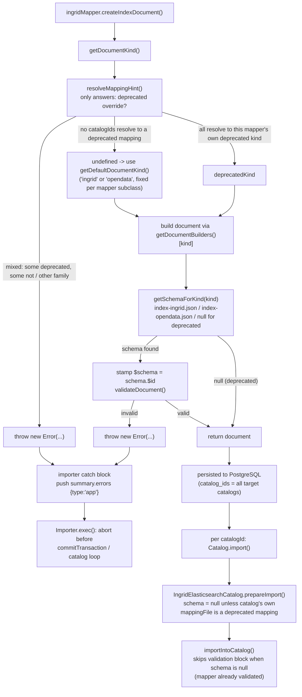

## Architecture

## Data Model

- `shared/catalog.ts`: `ElasticsearchCatalogSettings.settings.mappingFile` — `string` → `string | undefined` (optional). Unset (recommended going forward) or `'default-mapping'` = live/unified format; `'default-mapping.deprecated'`/`'opendata-mapping.deprecated'` = deprecated format (unchanged behavior). `'opendata-mapping'` is **no longer valid** — see NFR-001; `getIndexMappings()` has no fallback and throws on a missing mapping file.
- `server/app/profiles/ingrid/persistence/default-mapping.json` becomes the single live ES mapping: union of the 15 shared live fields, `ingrid`, `dcat`, `legal_basis`, `distributions`, `political_geocoding_level_uri`, and merged `exports: { iso, rdf }` (none of the 5 deprecated-only fields `uuid`/`collection`/`t01_object`/root `modified`/`sort_hash`). `opendata-mapping.json` is deleted (was a duplicate of the same content).
- `server/config/ingrid/config-catalogs.json` — the one catalog using `mappingFile: "opendata-mapping"` had that line removed (now unset = live/unified format).
- ~~No change to `IngridIndexDocument` / `IngridOpendataIndexDocument` / `IngridDeprecatedIndexDocument` / `IngridOpendataDeprecatedIndexDocument` TS types.~~ Superseded by TASK-022: live `IngridSpecific` (`server/app/profiles/ingrid/model/index.document.ts`) and `mappings/ingrid.json` follow `index-ingrid.json` (schema commit 77f1a8a6), including `spatial_representation` (array, `grid.rectified`/`grid.referenced` in snake_case); the schema is interim array-shaped until the array-vs-object question is settled (TASK-023). Deprecated types unchanged.

## API / Interface

- `ingridMapper.resolveMappingHint()` — return type unchanged (`DocumentKind | undefined`), but now only ever returns a deprecated kind or `undefined` (never throws-and-returns; the mixed case throws).
- `ProfileFactory.getIndexSchemaByName(schemaName: string): object | null` — base-class method (`profile.factory.ts`), extracted from `getIndexSchema()`'s require/try-catch body; `getIndexSchema()` now delegates to it after resolving `mappingFile` → `schemaName`.
- `DocumentFactory<T>.getSchemaName(): string | undefined` — new abstract method on the shared, cross-profile contract (`model/index.document.factory.ts`) every Level-3 mapper implements. `ingridMapper` returns `this.getDocumentKind()` (already a string at runtime); `DiplanungMapper`/`LvrMapper` return `ProfileFactoryLoader.get().getProfileName()`.
- `ProfileFactory.validateIndexDocument(document: any, schemaName: string | undefined): void` — new concrete base-class method; looks up the schema via `getIndexSchemaByName()`, no-ops if `schemaName` is undefined or no schema file exists yet (`diplanung`/`lvr` today), otherwise stamps `$schema` and calls `validateDocument()`, throwing on failure. Supersedes `ingridMapper`'s old private `getSchemaForKind()`, which is removed.
- `ingridMapper.createIndexDocument()`, `DiplanungMapper.createIndexDocument()`, `LvrMapper.createIndexDocument()` — each now ends with `ProfileFactoryLoader.get().validateIndexDocument(result, this.getSchemaName())` before returning.
- `IngridElasticsearchCatalog.prepareImport()` — `this.schema` assignment logic changes to only resolve a schema for an explicitly deprecated `mappingFile`; otherwise `null`.
- `wfs.importer.ts`'s `extractCompleteFeatureType()` catch block — unchanged from before this feature; a `createIndexDocument()` failure inside the optional `harvestTypes` branch is logged as a warning there, same as any other error in that branch (see Key Decisions — the fatal/non-fatal distinction isn't threaded through this one narrow, optional path).
- `client/.../elasticsearch.type.ts` — `mappingFile` form field: `required: false`, plus an explicit client-only "not set" option prepended to the options list (a `mat-select` has no built-in clear affordance).

## Key Decisions

| Decision | Rationale | Alternatives considered |
|---|---|---|
| Move schema validation from catalog-write time into the mapper, at `createIndexDocument()` | The mapper already knows its resolved `DocumentKind`; catalog-level validation can never correctly handle a catalog fed by multiple kinds (FR-007) | Keep catalog-side validation only — rejected, this is the mechanism behind the original silent-data-loss bug |
| `mappingFile` optional + unified `default-mapping.json`/`opendata-mapping.json` content | Removes the catalog→kind coupling for live kinds with zero forced config migration (`getIndexMappings()` already defaults to `'default-mapping'` when unset) | A new third mapping file/value — rejected, adds a config knob for no benefit since the two live mappings have no field conflicts |
| Mixed deprecated/non-deprecated `catalogIds` on one importer throws (aborts run) instead of warn+fallback | Fails loud on a genuine misconfiguration instead of per-record silent schema-validation drops — the root cause this feature fixes | Keep warn+fallback — rejected, this is exactly the existing bug |
| No custom exception class; a plain, un-decorated `throw new Error(...)` for a fatal condition, matching the file's existing precedent | `conventions.md` → Error Handling: "No custom exception classes — use standard `Error`". An earlier iteration added a `fail()` helper that also logged (redundant — every importer's catch block around `createIndexDocument()` already logs at ERROR before accumulating the error) and decorated the `Error` with a `.fatal` marker property (only ever consulted by one narrow, optional WFS code path — removed once that path was reverted, see below) | An `Error` subclass (e.g. `FatalMapperError`) — rejected, violates project convention. A `fail()` helper with logging + a `.fatal` marker — tried, then removed as over-built once it was clear a plain `throw new Error(...)` (the pattern already two lines away in `createIndexDocument()`) was sufficient everywhere except one rare edge case, which was judged not worth a bespoke mechanism for |
| `opendata-mapping.json` deleted entirely (not kept as a duplicate) once its content became fully redundant with `default-mapping.json` | Two files with identical content forever needing to stay in sync is worse than one; the codebase already has an established, low-cost way to keep an old config value working (a `try/catch`-with-fallback like `getIndexSchema()`'s), but the team chose the breaking-change path instead, accepting that any deployment's `config-catalogs.json` with `mappingFile: "opendata-mapping"` needs manual migration | Keep as a duplicate for zero-migration backward compatibility — the initial approach, reversed once the redundancy was pointed out; give `getIndexMappings()` a `getIndexSchema()`-style fallback instead of deleting — considered, explicitly declined in favor of a clean breaking change |
| WFS `harvestTypes` gap **not** fixed — reverted to its pre-feature behavior (any error in that branch, including a fatal mapper error, is logged as a warning, not promoted to a run-aborting `type: 'app'` error) | Once the `.fatal` marker was removed, fixing this would have required either reintroducing a marker/decoration (rejected above) or importing an ingrid-specific error type into the profile-agnostic `wfs.importer.ts` (rejected — cross-profile layering violation per `architecture.md`). The gap only matters when `settings.harvestTypes` is enabled *and* a mixed-catalog/validation-failure condition occurs in that same branch — narrow enough to accept as a known, pre-existing-style limitation rather than engineer around | A `.fatal`-marker check in that one catch block — implemented, then reverted alongside the `fail()` removal for consistency |
| `getAvailableIndexMappings()` trimmed to only the 2 deprecated entries; `getSchemaForKind()` resolves the schema directly by `DocumentKind` (`ProfileFactory.getIndexSchemaByName()`) instead of reverse-looking-up through the mapping-options list | The live 'InGrid'/'OpenData' entries were only ever kept to support that indirection; once removed, offering them in the catalog admin's dropdown was misleading (picking one had zero effect). Removing them also exposed and forced a fix of a real bug in `resolveMappingHint()`'s mixed-catalog classification (an old-style explicit `mappingFile` value with no matching list entry was silently not counted as "non-deprecated") | Keep all 4 entries indefinitely — rejected once the indirection was recognized as unnecessary; the client needed a new explicit "not set" option added instead, since a `mat-select` has no built-in clear affordance |
| Schema validation generalized onto `DocumentFactory<T>` (`getSchemaName()`) + `ProfileFactory` (`validateIndexDocument()`), so `diplanung`/`lvr` can opt in too, instead of into `Mapper<S>` (Level 2) | `DocumentFactory<T>` is the actual shared, cross-profile contract every profile's Level-3 mapper implements; `Mapper<S>` is shared *by format*, not by profile, has no notion of schemas, and its own `createIndexDocument()` is dead code (every importer calls the Level-3 wrapper's, never the raw Level-2 mapper's). `getSchemaForKind()`'s old logic collapses into `getSchemaName() { return this.getDocumentKind(); }` since a `DocumentKind` already *is* the schemaName | Move the call into `Mapper<S>` (`server/app/importer/mapper.ts`) — rejected: wrong layer, would invert the profiles-wrap-mappers dependency direction and couple generic format-mapping code to profile-specific schema knowledge |
| Integration tests split by folder: live format in `server/test/integration/` + `server/test/data/`, deprecated format in `server/test/integration-deprecated/` + `server/test/data-deprecated/` (expected output only; `input/` stays shared under `test/data/`). Shared `integration-test-runner.ts` is deprecated-agnostic — only generic optional `mappingFile`/`expectedDocsBaseFixture` fields; the importer-type → deprecated-mapping knowledge lives in `integration-deprecated/deprecated.util.ts` | Removing deprecated support later is exactly `rm -rf` of those 2 folders, no code edits anywhere else | A `live` flag / options parameter on `runImporterIntegrationTest()` and `elasticsearch-deprecated/` subfolders next to the live fixtures — tried and rejected: leaves deprecated knowledge in the shared runner and scatters deprecated fixtures across `test/data/` |
| `directus` catalog (FR-010) always uses `incremental` import sessions; deletes come from the bucket (`deleted`) and, on unlinking a datasource, from the database (`getDocumentIdsBySourceAndCatalog`, by `sourceURL` + `catalog_ids`, since `record` stores no datasource id) | One catalog can be fed by several datasources; a `full` session removes every record not sent in that session, i.e. the records of all other datasources. `full` is only used by `deleteCatalog()` (empty session = remove all) | `full` per harvest run as in IGE (`DirectusIndexer`) - rejected, only correct for a catalog with a single datasource |
| After the commit the `directus` catalog polls the session (`GET …/imports/{import_id}`, 2 s, timeout 10 min) and reports counters and `errors[]` in the `Summary` | Processing on the server is asynchronous (`202`); without polling, rejected records would never be visible in the harvester | Commit only, as IGE - rejected by the user |
| The `directus` catalog reports each rejected record with the `CswCatalog` error pattern (`numErrors++` = "Record-Errors", one `errors[]` entry of type `catalog`, `log.error`) in its catalog stage summary | User decision: an existing pattern, the server log is the place for catalog errors, no change to `Summary` or the importer. The frontend reads only the importer's main summary and therefore does not show catalog stage errors (pre-existing for all catalogs) | Directus throws one summary error that the importer catches - rejected, one error instead of one per record; `Importer.adoptStageErrors()` moving the stage errors into the main summary, and listing all errors after `Record-Errors` in `Summary.print()` - implemented, then reverted by the user |
| New-format bucket helpers (`prioritizeAndFilter`, `resolveCoupling`, `createIdfForWfs`, `isCsw`/`isWfs`, …) moved from `IngridElasticsearchCatalog` into `profiles/ingrid/catalog/ingrid.bucket.utils.ts` | `IngridDirectusCatalog` must send the same documents as the ES catalog (coupling, WFS IDF); deprecated-shape helpers stay in the ES catalog since Directus accepts the new format only | Copy into the Directus catalog - rejected, duplicated logic; a common base class - rejected, the two catalogs have different base classes |
